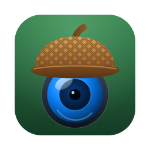

# oak-cam



oak-cam turns a Luxonis OAK-D Pro (USB or PoE) into three OS virtual webcams,
one per sensor: **OAK RGB** (IMX378), **OAK Left** and **OAK Right** (OV9282
mono). It is a small Rust app over a C++ shim on
[depthai-core](https://github.com/luxonis/depthai-core) v3.10.0, with native
virtual-camera backends for macOS (CoreMediaIO camera extension), Linux
(v4l2loopback) and Windows 11 (Media Foundation virtual camera).

**Downloads:** the signed, notarised macOS app (DMG) and the Windows and
Linux test builds are on the [releases page](https://github.com/schofield/oak-cam/releases).

## Build

You need Rust (the toolchain in `rust-toolchain.toml` installs itself through
rustup), CMake and a C++17 compiler.

1. depthai-core, once:

   ```sh
   # macOS: brew install cmake ninja pkg-config
   # Linux: sudo apt install cmake ninja-build pkg-config libudev-dev libusb-1.0-0-dev
   scripts/depthai/build.sh            # source build, 20 to 60 minutes cold
   ```

   It installs to `~/.cache/oak-cam/depthai/v3.10.0` with a `current` link
   that the build finds. On Windows, from PowerShell (needs Visual Studio 2022
   Build Tools with C++, and CMake):

   ```powershell
   powershell -ExecutionPolicy Bypass -File scripts\depthai\fetch-windows.ps1
   ```

   which downloads Luxonis's prebuilt win64 release (SHA-256 pinned) plus the
   OpenCV package it links, and builds the libusb DLL it loads for USB devices,
   into `%LOCALAPPDATA%\oak-cam\depthai`. Put
   `%LOCALAPPDATA%\oak-cam\depthai\current\bin` on `PATH` to run from `target\`.
   `DEPTHAI_PREFIX=<dir>` points the build at any other install.

2. The app: `cargo build --release` (the binary is `target/release/oak-cam`).

## Run

```sh
oak-cam --list                      # USB and PoE devices (--json for scripts)
oak-cam --probe                     # sensors, USB speed, IR drivers
oak-cam --headless --stats          # stream all three sensors to the virtual cameras
oak-cam --headless --no-vcam --stats  # capture only, print fps / latency / drops
oak-cam --headless --no-vcam --stats --duration 60  # stop cleanly after 60 s instead of Ctrl-C
oak-cam vcam status                 # virtual camera state
oak-cam vcam test-pattern --camera all  # bars / gray steps, no device needed
```

Logs: `RUST_LOG=debug DEPTHAI_LEVEL=debug oak-cam ...`. The GUI (`oak-cam`
with no arguments) also writes connection events and warnings to
`~/Library/Logs/oak-cam/oak-cam.log` (macOS), `%LOCALAPPDATA%\oak-cam\logs\oak-cam.log`
(Windows) or `~/.local/state/oak-cam/oak-cam.log` (Linux), shown in its Device
tab; `RUST_LOG` affects only the terminal output.

### Stream profiles

Stream sizes and frame rates follow the link, because bandwidth is the limit
(RGB NV12 1.5 B/px, mono 1 B/px). When a device connects, oak-cam applies the
profile for its link type:

| Link | RGB | Mono (each) | Approx. load |
|---|---|---|---|
| USB3 | 1920x1080 @ 30 | 1280x800 @ 30 | 1.24 Gbps |
| PoE | 1280x720 @ 20 | 640x400 @ 20 | 60 frames/s + 303 Mbps, 76 % load |
| USB2 | 1280x720 @ 12 | 640x400 @ 12 | 182 Mbps of ~320 |

The PoE limit is a per-frame cost on the camera's network path (about 8.5 ms
per frame across all streams) plus bytes near the gigabit rate, so three
streams at 30 fps overrun it whatever the size, while 1080p15 with 800p15
monos (620 Mbps) runs; the top bar shows this as "PoE load".

Size and fps edits made in the GUI while connected are remembered for that
link type; the top bar shows `PoE defaults` or `PoE custom`, and Reset (there
or on the Device tab) returns to the defaults. In the config file the custom
profiles are `[profiles.poe]`, `[profiles.usb3]` and `[profiles.usb2]`, each
with `rgb = { width = ..., height = ..., fps = ... }` and `mono = { ... }`;
without them the built-in defaults apply. `--headless` never writes the file:
editing `[rgb.stream]` / `[mono.shared.stream]` while it runs keeps those
sizes for the current link until it exits, and to keep them across runs put
them in the link's `[profiles.*]` table. A mono camera with its own size or
rate (a per-camera override) is recorded in the profile as `left = { ... }` or
`right = { ... }`. Older oak-cam builds reject a config file that contains
`[profiles.*]` (unknown keys are an error and the format version is still 1),
so remove those tables before going back to one.

### PoE cameras

A PoE OAK is powered by the cable, so it needs an 802.3af PoE switch or
injector between it and the computer; a plain Ethernet port gives it no
power and the link stays down. On a network with DHCP the camera takes an
address and `--list` finds it (discovery is a UDP broadcast on port 11491,
data is TCP 11490). Plugged straight into a computer with no DHCP server, the
camera falls back to `169.254.1.222/16` and the computer self-assigns a
`169.254.x.x` address on that port; `--list` should then find it, and
`--device 169.254.1.222` (or the GUI's manual IP box) connects without
discovery. `--list` is a fixed half-second scan.

The fallback happens twice. The bootloader (what `--list` sees before a
connect) takes `169.254.1.222` after its flashed DHCP timeout (30 s from the
factory; it can be set lower, for example 10 s). Once oak-cam boots it, the
camera's firmware asks for DHCP again for about 30 s before falling back, so
oak-cam boots PoE cameras with a longer initial watchdog and the first
connect on a direct cable takes about 30 s. oak-cam raises depthai's boot
wait to 90 s for all devices; USB boots take 1-3 s, so it only matters when a
device vanishes after boot. `DEPTHAI_BOOTUP_TIMEOUT` (milliseconds) overrides
that wait, and `DEPTHAI_SEARCH_TIMEOUT=10000` (milliseconds) lengthens the
search when opening a device that is slow to appear.

### macOS virtual cameras

The cameras come from a CoreMediaIO system extension inside `oak-cam.app`.
macOS only activates a Developer ID system extension from a **notarised** app
in `/Applications` whose provisioning profile grants the System Extension
capability (ad-hoc signing only works with SIP off and
`systemextensionsctl developer on`). The one-time App ID and profile setup is
in `extensions/oak-camera-extension/README.md`. Then:

1. `scripts/vcam/build-macos.sh --provisionprofile <app profile> --notarize <notarytool profile>`
   builds, signs, notarises and installs `/Applications/oak-cam.app`.
2. `/Applications/oak-cam.app/Contents/MacOS/oak-cam vcam install`
3. Approve "OAK Cameras" in System Settings > General > Login Items & Extensions >
   Camera Extensions (macOS 14: System Settings > Privacy & Security).
4. `/Applications/oak-cam.app/Contents/MacOS/oak-cam vcam status` should say `active`.

Quit and reopen Photo Booth (and any other camera app that was running) after
the first approval; apps that were open keep their old camera list.

`scripts/vcam/build-macos.sh --check --identity -` builds and verifies the
bundle without installing (what CI runs).

### Linux and Windows virtual cameras

Linux: load `v4l2loopback` (`oak-cam vcam status` prints the command).
Windows 11: from an administrator PowerShell, once,
`.\scripts\vcam\build-windows.ps1 -Register`.

## CI

- `.github/workflows/self-hosted-ci.yml`: every push to `main` and every pull
  request, on the owner's box (Linux or Windows, whichever it is booted into).
- `.github/workflows/ci.yml`: hosted macOS, Ubuntu and Windows, weekly and on
  demand, plus a `depthai-next` job that builds against the next depthai-core
  tag to catch API drift early.
- `hardware.yml` (device tests with the OAK attached) and `package.yml` (test
  packages) run by hand on the self-hosted box: `gh workflow run hardware.yml -f os=linux`.
  `package.yml -f os=linux-hosted` builds the Linux package on a GitHub-hosted
  runner instead.
- The signed macOS package comes from the owner's Mac, registered as a
  `[self-hosted, macos]` runner by `scripts/ci/setup-macos-runner.sh`:
  `gh workflow run package.yml -f os=macos` runs
  `scripts/vcam/build-macos.sh --check --provisionprofile … --notarize …`
  with the Developer ID identity in that Mac's keychain (the profile and
  notarytool names come from the repository variables
  `OAK_MACOS_PROFILE_NAME` and `OAK_NOTARY_PROFILE`), then
  `scripts/ci/package-macos.sh --dmg --notarize …`, which verifies the
  signature, the stapled ticket and the Gatekeeper assessment and writes
  `dist/pkg-staging/oak-cam-<version>-macos-<arch>-<sha7>.zip`, a notarised
  `.dmg`, `SHA256SUMS.txt` and `BUILD-INFO.json`. The same two scripts work
  from a shell on the Mac.

## Contributing

See [CONTRIBUTING.md](CONTRIBUTING.md). Licensed under [MIT](LICENSE);
third-party notices are in [THIRD_PARTY_LICENSES.md](THIRD_PARTY_LICENSES.md).
